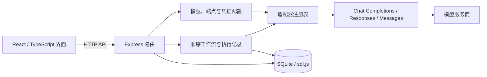

# API Tools

API Tools 是模型 API 管理与调用工作台，用于配置模型服务商、模型和端点，测试调用，并查看工作流及各步骤的执行记录。

## 为什么需要统一调用入口

不同服务商的接口在请求字段、消息格式和响应结构上存在差异。若界面、端点测试和工作流分别处理这些差异，相同的协议逻辑会被重复实现。

项目将 OpenAI Chat Completions、OpenAI Responses 和 Claude Messages 分别封装为适配器。注册表根据服务商配置选择实现，上层通过统一操作入口发起调用；不支持的操作会返回明确错误。

## 主要功能与模块

- **模型接入**：管理服务商、模型与端点，记录使用的协议类型和能力配置。
- **凭证管理**：服务商配置保存 API Key 对应的环境变量名；实际凭证由环境配置读取，配置导入导出与凭证保存分别处理。
- **端点与调用测试**：检查配置，并通过相应协议发起模型调用。
- **工作流记录**：按顺序执行步骤，保存每次执行及各步骤的状态、输出和错误，便于定位失败位置。
- **管理界面**：通过 React 页面管理配置和查看执行记录；仓库还包含 MCP、Skill 和用量统计相关模块。

## 系统架构



前端负责表单、反馈与记录展示，Express 后端组织调用和存储。数据库通过 sql.js 运行 SQLite，并将数据保存为本地文件。这样，协议差异、工作流逻辑和界面状态可以分别维护。

## 代码结构

| 目录 | 职责 |
| --- | --- |
| `client/` | React、TypeScript、Vite 界面 |
| `server/src/routes/` | HTTP API 与输入检查 |
| `server/src/adapters/` | 服务商协议适配 |
| `server/src/apiProtocol/` | 统一操作及输入输出定义 |
| `server/src/workflows/` | 顺序执行与步骤状态保存 |
| `server/src/db/` | 数据库结构与文件保存 |
| `server/src/configuration/` | 配置导入导出 |

## 本地运行

在仓库根目录执行：

```bash
npm ci
```

将 `.env.example` 复制为本机 `.env`，按需填写模型服务商凭证与数据库路径，然后启动：

```bash
npm run dev
```

前端开发地址为 `http://127.0.0.1:5173`，后端默认端口为 `8787`。

## 测试与验证

```bash
npm run typecheck
npm test
npm run build
```

测试覆盖协议适配、配置与接口处理，以及部分前端页面交互。历史版本有后端 118 项、前端 40 项测试及构建检查记录；后续新增模块的结果需按其版本单独查看。

## 当前状态与限制

- 当前工作流按步骤顺序执行，失败时记录错误与执行状态。
- 后端启动代码未显式限定回环监听地址，且存在写入 API Key 配置的管理接口；管理接口认证和网络访问边界仍需完善，当前适合受控本机或隔离环境使用。
- 本地配置、凭证和数据库文件需要独立保护，不进入演示资料或公开配置包。

项目采用 AI 辅助开发，具体设计、实现与验收分工仍在整理。许可证尚待明确。

[源代码](https://github.com/Nuwanda218/API-TOOLS)

更新：2026-11-25
